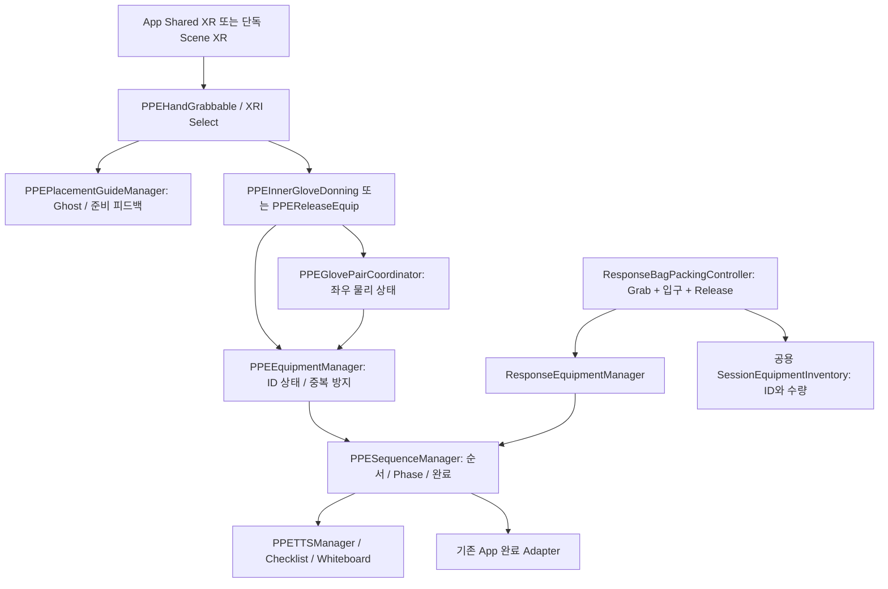

# PPE 준비실 기술 감사

감사일: 2026-10-27 (한국 시간). 기준 저장소: `tyfmq123-hub/HCl-PPE-Room-Build`, 수신 커밋 `871f806165eebb9e03ba944ed95db5af3dc83819`. 작업 브랜치: `codex/ppe-portfolio-improvement`.

이 문서의 **구현 확인**은 소스를 읽은 분석이며 실제 실행 결과와 구분한다. 후속 검증에서 Unity 6000.4.8f1 import·컴파일 오류 0개, 신규 EditMode 50/50 통과, 전체 217/218 통과를 확인했다. 로드한 PPE 씬의 Missing Script·끊어진 직렬화 참조는 각각 0개다. 기존 손 색상 정밀도 테스트 1개 실패와 PlayMode·PCVR·Quest·새 player 빌드 미검증이 남는다. 최신 근거는 [테스트 보고서](02_TEST_REPORT.md)다.

## 1. 범위와 원본 보존

- 필수 선행 문서인 [PPE 작업 규칙](../codex/PPE_WORKER.md), [작업지시서](../tasks/PPE_TASK.md), [수정 경계](../integration/STAGE_EDITING_BOUNDARIES.md), [전체 PPE 인수인계](../handoffs/ppe/LATEST.md), [Shared XR 구조](../integration/SHARED_XR_ARCHITECTURE.md), [Inventory 계약](../integration/SESSION_INVENTORY_CONTRACT.md)을 확인했다.
- 기존 문서의 `feature/ppe` 브랜치 지침보다 이번 사용자가 지정한 별도 포트폴리오 브랜치를 우선한다. 허용 범위는 PPE 소스·테스트 및 요청받은 README/포트폴리오 문서다.
- `Assets/Common/XR/`, `Assets/Scripts/App/`, 다른 Stage, `Packages/`, `ProjectSettings/`, 기존 빌드 바이너리는 보호한다. Scene GUID와 기존 `.meta`를 유지한다.
- 원래 팀 저장소의 코드와 이력은 보존한다. 최초 보강·검증 회차에는 커밋·푸시·PR을 하지 않았고, 후속 공개 요청에서 포트폴리오 브랜치의 커밋·푸시·PR 생성이 승인됐다. PR 자동 병합과 새 player/Release 게시는 범위 밖이다.
- 지원자 확인에 따라 원래 프로젝트는 **3명 팀 개발**이며 **지원자가 PPE 준비실 Stage의 씬·보호구 상호작용·교육 흐름·대응 장비 준비·전용 UI·안내와 관련 Stage 기능을 전담 개발**했다. 다른 Stage와 공용 App/XR, 외부 자산을 개인 단독 제작물로 소개하지 않는다. 2026-10-27 보강·회귀 검증은 원래 개발 기간 이후 작업이다.

## 2. 버전과 빌드의 의미

| 구분 | 확인된 사실 | 해석 제한 |
|---|---|---|
| Unity | `ProjectSettings/ProjectVersion.txt`: **6000.4.8f1**, revision `f8b72d3d7343` | 다른 6000.4 버전을 같은 실행 검증으로 대체하지 않음 |
| 소스 | `EXPORT-MANIFEST.json`: 2026-09-18 export, 원본 branch `integration/ppe-portfolio-demo`, base `db1a980f793a0d2c4924102e8c51cf086a8f1d95`, 미커밋 demo 변경 포함 | 원본 base commit만 checkout한 상태와 동일하지 않음 |
| 기존 Windows 데모 | 같은 manifest: **2026-09-10** 빌드 | 9월 18일 소스나 이번 수정의 실행 결과가 아님 |
| 원래 README 경고 | 9월 14일 본 프로젝트 신발 고스트 수정이 기존 데모에 반영되지 않았다고 명시 | 소스·데모의 행동 일치 보장 불가 |
| 현재 실제 검증 | 정확한 Unity 6000.4.8f1 import·컴파일 오류 0개, 신규 50/50 통과, 전체 217/218 통과 | 기존 Tint 정밀도 1개 실패. PlayMode·PCVR·Quest·새 player 빌드는 미검증 |

`EXPORT-MANIFEST.json`의 해시는 원래 export의 증거다. 이번 수정 파일의 최신 해시나 새 실행 검증서로 해석하지 않는다. 인수인계에 있는 과거 `160/160`, `162/162`, smoke PASS 등은 **당시 원본 버전의 역사적 기록**이며 이번 checkout의 테스트 결과로 재사용하지 않는다.

### PPE 전용 빌드 경로

[`PPE Portfolio Demo Win64.asset`](../../Assets/Settings/Build%20Profiles/PPE%20Portfolio%20Demo%20Win64.asset)은 Win64 프로필이며 `HCL_PPE_DEMO`를 정의한다. 첫 Scene은 `04_PPE`; 이후 App/Title/Start/타 Stage/Complete Scene도 호환성 때문에 목록에 남는다. 단순히 다른 Scene을 지우거나 Classic Build Settings로 전환하면 안 된다.

[`PpePortfolioDemo.cs`](../../Assets/Scripts/App/PpePortfolioDemo.cs)는 컴파일 심볼만으로 데모 여부를 결정한다. 보호된 App의 `StandaloneStageRedirect`, `SceneFlowController`, 메뉴와 telemetry uploader/dashboard 경로가 이 값을 사용한다. 이는 **구성 및 코드 경로 확인**이며 새 Win64 빌드 성공 증거는 아니다.

## 3. 주요 C# 구조

- **입력·표현**: XRI grab과 가이드가 장비를 조작한다. `PPEEquipable`은 장비 ID, 슬롯, 거리/회전 허용치, 로컬 착용 상태를 보관한다.
- **좌우 물리 상태**: 속장갑·외부 장갑·장화는 두 물리 부품을 각각 처리한다. 어느 쪽을 먼저 할지는 고정하지 않는다. 두 부품이 완성되어야 하나의 논리 장비 ID를 등록한다.
- **장비 상태**: `PPEEquipmentManager`는 equipped/prepared 목록과 `HashSet`을 관리하고, 중복·불완전 pair·잘못된 순서를 거부한다. XRI 선택을 정리한 뒤 표시를 갱신한다.
- **교육 상태**: `PPESequenceManager`가 `Donning → EquipmentPreparation → Complete`와 현재 단계, 완료 집합을 소유한다. `CanEquip`과 `CompleteEquip`이 순서를 검증한다.
- **Scene 연결**: Stage는 `OnPPESequenceCompleted`만 전달하고 App이 완료 후 이동을 맡는다. PPE 코드에서 새로운 Scene 전환을 구현하지 않는다.
- **Scene 사이 데이터**: `PPELoadoutData`와 공용 `SessionEquipmentInventory`가 ID 상태를 전달한다. 물리 장비 GameObject를 다른 Stage로 옮기는 방식이 아니다.

## 4. 실제 구현된 교육 흐름

| 기능 | 확인된 구현 | 확인되지 않은 것 |
|---|---|---|
| 착용 순서 | 속장갑 → 화학보호복 → 양쪽 장화 → 호흡보호구 → 안면보호구 → 양쪽 외부 장갑 | 산업 현장 SOP 적합성에 대한 전문가 승인 |
| 준비 순서 | 대응가방 → 폐기물 수거용기, 이후 전체 완료 이벤트 | 이번 변경의 App 전체 재실행 |
| 실제 착용 | 직접 Grip으로 잡고 대상 위치에서 놓을 때 검증 | Quest에서 거리·손 배치·편안함 |
| 장갑 | 반대 손으로 잡기, 좌우 독립 상태, 양쪽 완료 시 논리 Equip, 속장갑 손색 피드백 | 손 추적 및 controller 전환의 실기기 일관성 |
| 장화 | 하체 위치와 body yaw를 따르는 target, 아래를 볼 때 Ghost 표시 | 실제 발 위치 추정의 정확성; 발 tracking 자체를 구현한 것은 아님 |
| 얼굴/몸 장비 | 현재 HMD/몸 기준의 보이지 않는 target, release 거리 검증 | 전 장비의 착용 후 전용 mesh 표현 |
| 가방 | 측정기·흡착패드·흡착삭을 개별 Grab, 입구에서 Release, snap/숨김/Inventory 기록, 마지막 가방 Grip | 집게까지 네 종류를 실제 수납하는 흐름 |
| 안내 | 37개 PPE cue 매핑, 2D 음성 queue, 완료 cue 우선, whiteboard와 cue 시작 연계 | 음성 청취·지연·발음·Quest 출력 검수 |
| UI/자료 | checklist, 이름표, 선택/outline, SDS 관련 경로가 존재 | 모든 UI의 HMD 가독성 및 실제 자료 열람 동작 |
| Reset | release 억제 → 선택 취소 → 가이드/상태/pair/보관 pose 복원 → sequence reset | 잡은 상태·부분 착용·완료 후 실제 반복 실행 |

현재 기본 순서에는 **Helmet이 없다**. 타입/ID/Head-slot 경로는 존재하지만 인수인계상 승인된 Helmet 3D 자산 및 SOP 순서가 없다. 완성 기능으로 소개하지 않는다.

## 5. 핵심 스크립트 검토

| 스크립트 | 책임 및 검토 결과 |
|---|---|
| `PPESequenceManager.cs` | 두 Phase와 현재 required step, completed set, bag checked, reset 및 App 완료 이벤트. 오입력 `ContentViewed` 의미 오류와 TTS busy 동안 보고 누락 확인. 공용 의미 변경은 Integration 제안으로 남김. |
| `PPEEquipmentManager.cs` | 로컬/manager 중복 검증, pair 완료 gate, sequence gate, 장비 상태·XRI 정리·성공 이벤트·loadout sync. `Equip`의 bool 결과를 상위 pair 로직이 확실히 처리해야 함. |
| `PPEEquipable.cs` | 직렬화된 identity·slot·reference·허용치와 로컬 equipped 상태. `CanEquip`은 manager 중복도 검사. Ghost calibration 생성은 ResponseBag 제외. 기존 필드/메타 보존 대상. |
| `PPEInnerGloveDonning.cs` | 자연 SelectExited에서 captured holding hand, 반대손, 유효 Palm/grace, 거리, sequence 검증. radius 기본 0.15m, tracking release grace 0.30s, rotation 미사용. 결과를 받아야 물리 equipped 상태로 진행. |
| `PPEGlovePairCoordinator.cs` | 좌우 상태/시각/물리 숨김 및 양쪽 완료 시 논리 등록. 이번 감사에서 manager 실패 후 좌우가 true로 남는 실제 경로 확인; 실패 시 이번 측만 복구하도록 보완. |
| `PPEGlovePairMember.cs` | side·coordinator·target·equip reference·손 규칙 연결. tracking hand pair와 body lower-leg pair를 같은 coordinator로 연결하되 opposite-hand 요구는 해당 구성에 따름. |
| `PPEDirectGrabProximityFilter.cs` | XRI select filter. 이미 잡은 선택을 유지하고 최초 select에만 물리 collider 거리 적용. 기본 0.06m, 장화는 authored 설정. NearGrabAssist는 hover용이며 장갑 select 범위를 키우지 않음. |
| `PPEPlacementGuideManager.cs` | grab/release 구독, live target, renderer-only Ghost, 거리/회전 평가, Ready, release 후 등록 경로. 대부분 wearables는 hold auto-equip 대신 release 경로 사용. 전체 재작성 필요 없음. |
| `ResponseBagPackingController.cs` | 세 물리 packable, 입구 판정, slot snap, 마지막 확인 입력. global shared Grip fallback의 가방 문맥 누락 확인; 가방 상호작용 조건을 추가. |
| `ResponseEquipmentManager.cs` | bag inspected/prepared 상태, 원래 pose/reset, UI 및 논리 PPE/Inventory 호환. 세 `RequiredBagContentIds`가 모두 기록되어야 준비 허용. legacy UI/API는 유지. |
| `PPETTSManager.cs` | canonical Resources → Inspector → legacy Resources fallback, queue와 실제 AudioSource 재생 상태를 기준으로 다음 cue 진행. OnDisable/OnDestroy에서 구독 해제/재생 종료. 실제 오디오 장치 확인 필요. |

## 6. 확인한 결함과 수정 방향

### A. 가방과 무관한 Grip으로 마지막 준비가 완료됨

기준 버전 `ResponseBagPackingController.OnSharedInputPerformed`는 `SharedXRHand` 인자를 `_`로 버리고, 장비가 모두 수납되었다는 조건 후 다음 Grip을 바로 `TryCompleteResponseBagPreparation`으로 전달한다. 가방을 hover/select했는지 또는 해당 손이 가방 근처인지 검증하지 않는다. 따라서 방 반대쪽에서 누른 Grip도 가방 수집으로 해석될 코드 경로가 있다. 기존 XRI callback과 router에 문맥 검사가 있더라도 이 별도 전역 입력 경로가 우회한다.

이번 보완은 마지막 Grip에도 **현재 활성 bag XRI interactable의 live hover/select**를 요구한다. 알려진 입력 손은 interactor handedness와 일치해야 한다. 예전에 sticky 선택했다는 사실만으로 완료하지 않고, 다른 손 hover나 비활성 bag/interactable도 거부한다. `ResponseBagPrepareInteractable`에 문맥 검사를 모아 global fallback과 `XRInteractionConfirmRouter`가 같은 검사를 사용하게 한다. 수납 순서 자유, 세 종류 규칙, 마지막 별도 Grip, WasteContainer 후속 단계, public API 및 shared input 계약은 유지한다. 실제 구현·테스트 파일은 테스트 보고서의 변경 목록을 함께 참고한다.

### B. 양쪽 장갑 완료 후 논리 등록 실패가 남기는 상태 불일치

기준 `PPEGlovePairCoordinator`는 두 번째 side flag를 true로 만든 뒤 `PPEEquipmentManager.Equip(LogicalItem)`을 호출한다. manager가 없거나 `Equip`이 false이면 물리 양쪽 완료/숨김과 manager의 논리 ID가 어긋날 수 있다. false 반환은 중복 ID, 로컬 이미 equipped, sequence 변경/차단 등 실제 guard로 가능하다.

이번 보완은 기존 `BothEquipped` manager gate를 위해 두 번째 flag를 일시 적용하되, 등록 실패 시 **이번에 시도한 side만** 되돌린다. 먼저 착용한 쪽은 유지하고, 거부된 쪽은 원래 보관 pose·grab·착용 시각을 복구해 재시도 가능하게 한다. release와 placement의 공통 완료 경로로 처리한다. 외부 coordinator 소속 member도 거부한다.

연결 결함도 있었다. `PPEReleaseEquip.TryEquipPairMember`가 coordinator의 bool 반환값을 무시하고 항상 `NotifyEquipped`/true를 반환했다. 이제 coordinator 거절 시 false로 나와 source가 성공 상태로 잘못 고정되지 않게 한다. InnerGlove release 경로는 원래부터 bool을 검사한다.

### C. 거부 입력을 콘텐츠 열람으로 기록함 — Integration 요청

`PPESequenceManager.NotifyEquipBlocked`의 기준 소스 약 426행은 `SharedTrainingTelemetry.Current.ContentViewed("PPE.EquipBlocked." + telemetryStep)`를 호출한다. PPE 착용 거절은 설명/SDS 열람과 의미가 다르다. 또한 위의 TTS busy 조기 반환으로 어떤 거절은 기록되지 않는다.

이번에는 기존 공용 계약을 임의로 변경하거나 오입력을 설명 열람 이벤트로 재분류하지 않는다. Integration에서 현재 interaction 문맥에 맞는 `InteractionAttempted` 경로 또는 승인된 장비 시도 이벤트를 노출하고, 원래 content 지표와 분리해야 한다. 이벤트 ID/손/요구 input/중복 억제 기준과 기존 서버 집계를 함께 검토해야 한다. App/shared telemetry 구현은 수정하지 않는다.

## 7. 배치·추적·성능 검토

### Release와 Ready

- 일반 pair 및 단일 장비의 공통 위치/회전 계산은 `PPEPlacementValidation.Evaluate`를 사용한다. 대상 유효성, 거리, 선택적인 angle, sequence를 분리해 결과를 표현한다.
- 속장갑은 `PPEInnerGloveDonning`이 직접 거리만 검사한다. 기본 0.15m, last valid Palm grace 0.30s. debug loose 0.50m는 개발용이며 기본 off다.
- Scene에 확인된 단일 장비 release 거리는 FaceShield/Respirator 0.35m, Suit 0.45m이며 `useRotationValidation: 0`이다. 과거 handoff의 0.18/0.20/0.30m 값을 현재 설정으로 소개하면 안 된다.
- 일반 Ghost Ready에는 `readyExitDistanceExtra=0.03m` hysteresis가 있다. 이는 visual 안정성을 위한 것이며 release 임계값은 늘리지 않는다. Ready 표시가 경계에서 남아 있어도 실제 release가 거절될 수 있으므로 기기 사용성 검수 항목이다.
- Ready는 pose 표현이고, sequence 불일치는 별도 status/gate가 처리한다. 따라서 초록/진한 Ghost만으로 논리 착용 성공을 판단하면 안 된다.
- 얼굴/머리/몸 슬롯은 `SuppressesGhostVisual`에 의해 Ghost renderer를 생성하지 않고 보이지 않는 live target을 쓴다. 장갑/장화와 같은 시각 UX라고 설명하지 않는다.

### Tracking source와 grace

`PPEGloveHandTargetFollower`는 XRHands Palm/Wrist를 world로 변환하고 AutoActive에서 controller interaction source를 fallback으로 사용한다. `OnEnable`은 명시 ControllerFallback 외 설정을 AutoActive로 바꾼다. 즉 과거 문서의 “XR Hands 전용, 자동 controller fallback 없음”은 현 구현과 다르다.

XRHands pose 경로는 running subsystem, 손 `isTracked`, joint pose flag, `TryGetPose`를 확인한다. 추적 손실 시 기본 0.30s 동안 마지막 pose를 유지하고 이후 유효성을 해제한다. 다만 controller fallback은 **활성 Transform 존재**를 확인하며 하드웨어의 live tracking feature를 직접 검사하지 않는다. controller pose가 멈춰도 transform이 활성 상태이면 유효로 취급될 위험이 있다. 물리 tracking source 전환은 기기 검증 후 Integration 입력 계약과 함께 정해야 한다.

### 구독과 객체 수명

- Placement의 OnEnable/OnDisable에서 동일한 `GrabBinding` delegate를 등록/해제한다. `RefreshBindings`도 먼저 해제한다. OnDisable에서 가이드와 cached material을 정리한다.
- Hand follower는 subsystem 교체 전 기존 `updatedHands`를 해제하고 OnDisable에서도 해제한다. subsystem 미실행 재탐색은 0.5s 간격이다.
- TTS는 OnDisable/OnDestroy에서 queue/coroutine/audio 및 sequence 구독을 정리한다. 구독 해제 때 현재 `Resolve()` 결과를 쓰므로 추후 manager 교체 수명을 지원한다면 실제 구독한 instance 보관을 검토할 수 있다. 현재 single scene manager 경로에서 누수가 재현되었다고 단정하지 않는다.
- Placement/InnerGlove에는 development debug용 runtime Material 생성이 남는다. production 기본 off이며 실제 반복 object/material 잔류는 Profiler 및 reset 반복으로 확인해야 한다.

### 비용과 최적화 판단

- 대부분 Scene 탐색은 시작/바인딩/캐시 누락/Grab/Release/Reset에서 실행된다. 가이드 renderer와 재질은 잡을 때 생성하고 해제할 때 정리하며 매 프레임 새 Ghost를 생성하지 않는다.
- 남은 확인 가능한 비용: Hand follower `UpdateDebugFields`는 pose 갱신마다 `BuildPath`의 List 생성·Reverse·Join을 실행한다. Placement `PublishDebug`도 개발 log off여도 일부 label 문자열을 만든다. filter의 collider fallback은 `GetComponentsInChildren` 배열을 만든다.
- 이 항목은 코드에서 확인한 allocation 가능성이다. **프레임 시간, GC/frame, FPS 개선 수치는 측정하지 않았다.** Profiler에서 재현 후 debug path 캐시/개발 빌드 제한 등을 좁게 적용하는 순서를 권장한다.
- 소스 길이만을 이유로 대규모 분리/리팩터링하지 않는다. release·pair·Unity 수명·직렬화 결합의 회귀 위험이 더 크다.
- 단일 장비 `PPEReleaseEquip.TryEquipSingle`은 한 프레임 뒤 실행할 coroutine을 예약한 시점에 true를 반환한다. 그 뒤 manager 등록이 실패하면 물리 성공과 논리 상태가 달라질 여지가 있다. 정상 Scene에서의 재현·reset 교차 테스트 후 후속 범위로 다룰 문제이며 이번 pair 수정의 실행 검증으로 간주하지 않는다.

## 8. 명세 일치: 네 종류인가, 세 종류인가

| 증거 | 내용 |
|---|---|
| `docs/tasks/PPE_TASK.md` | 측정기·흡착삭·흡착패드·집게 네 종류를 Grip 수납한다고 요구 |
| `ResponseEquipmentManager.RequiredBagContentIds` | GasDetector / AbsorbentSock / AbsorbentPad **세 종류** |
| `ResponseBagPackingController.BindItems` | 위 세 실제 table root만 packable로 바인딩 |
| `docs/handoffs/ppe/LATEST.md` 2026-08-27~28 후속 | 세 장비 수납 후 별도 가방 Grip; WasteContainer 유지 명시 |
| `docs/audio/FULL_COURSE_TTS_SCRIPT.md` PPE 21/37 | 측정기·패드·삭을 수납하고 “세 가지” 후 가방 Grip 안내 |
| 공용 Inventory/LeakResponse 계약 | RecoveryTongs 데이터 ID 및 타 Stage 사용 존재; PPE 물리 수납 구현의 증거는 아님 |

**판정:** 최신 구현과 후속 handoff/음성 대본은 서로 세 종류 흐름으로 맞는다. 하지만 기존 확정 작업지시서의 네 종류 요구와의 공식 변경 승인은 찾지 못했다. 집게를 임의로 추가하거나 세 종류 규칙을 네 종류로 바꾸지 않았다. 현재 포트폴리오에는 **“세 종류 수납 구현, 집게 포함 여부는 SOP/Integration 확인 필요”**로 표기한다.

## 9. Shared XR/팀 기여 해석

통합 App은 Common XR Origin/Camera/Controller/Input/Interaction Manager/EventSystem의 단일 소유자다. PPE는 Stage gameplay·interactable·UI·TTS·target/profile 선언을 소유하고, 타 Stage는 각 담당 영역을 소유한다. Unity Samples, XR 패키지, 외부 모델/텍스처는 별도 출처 및 라이선스 대상이다.

`SHARED_XR_ARCHITECTURE.md`의 오래된 표는 PPE를 Standard Ray라 기술하지만 현재 `Assets/1.JSR/Resources/SharedXR/PPE.asset`은 `farInteraction: 0`, `nearInteraction: 1`, `handVisualMode: 3`이다. 최신 handoff와 음성도 직접 Grip + release를 설명한다. Ray/선택 코드가 존재한다는 사실과 현재 PPE 실행에서 visible far ray를 쓴다는 주장은 구분해야 한다. 이 감사에서는 공용 문서를 무단 수정하지 않고 불일치를 기록한다.

## 10. 기존 테스트와 검증 공백

- PPE 폴더: `PPEInnerGloveHandTintTests`의 색상 적용/복원 EditMode NUnit 테스트, `PPELoadoutSourceGuardSmokeTest`의 별도 실행 smoke 도구가 존재한다.
- 공용 Editor 테스트: App flow, Integration VR regression, Inventory, Scene loading budget가 있다. 다른 Stage에도 별도 asmdef 테스트가 있으나 PPE 소유 범위 밖이다.
- 신규 테스트는 실제 수정한 pair 등록/복구, 가방 완료/무효 상호작용, 순서·중복·reset을 우선한다. 실제 tracking·배치 임계값·고스트 Ready의 일치는 수동 기기 검증 대상으로 남긴다. 테스트 존재와 실행 성공은 구분한다.
- 설치 전 보조 .NET 검사는 Unity 전체 컴파일 근거로 사용하지 않는다. 이후 정확한 Unity 6000.4.8f1에서 실제 import·컴파일과 EditMode를 실행했으며 결과는 02 보고서의 최신 절을 따른다.
- 현재 검증에는 HMD 손 추적, PCVR/OpenXR 연결, Quest 단독 실행, 오디오 경로, frame performance 수치, Scene 전환 완료가 포함되지 않는다.

## 11. 우선순위

| 우선순위 | 조치 | 채용 포트폴리오에서의 의미 |
|---|---|---|
| 완료 | 정확한 Unity 6000.4.8f1로 컴파일·신규 EditMode suite 실행 | 오류 0개·신규 50/50 통과. 전체 217/218 및 기존 실패 1개 기록 |
| P0 | 가방과 무관한 final Grip 차단, pair 등록 실패 rollback 검증 | 실제 XR 업무 상태 불일치 해결 능력 |
| P1 | PCVR/Quest에서 전체 6+2 단계·좌우 모두·부분 reset·중복 입력 확인 | 산업 교육 흐름을 끝까지 완주하는 시연 증거 |
| P1 | 세/네 종류 SOP, 추적 손실 fallback, rejected telemetry 의미를 Integration 확인 | 팀 경계와 데이터 의미를 지키는 협업 능력 |
| P1 | 새 검증 버전을 별도 경로로 Win64 빌드하고 source commit/날짜 기록 | 소스와 실행물의 신뢰성 |
| P2 | 실제 PPE room/손 배치/수납/체크리스트 영상·스크린샷 확보 | 1분 이내로 기능을 이해하는 채용 화면 |
| P2 | Profiler capture로 frame time/GC와 반복 Guide/reset 메모리 확인 | 수치에 근거한 최적화 설명 |
| P3 | 확인된 필요에만 worn visual·Helmet·추가 장비 확장 | 외형 확장보다 안정된 core flow 우선 |

다음 확인 절차와 수동 PCVR/Quest 항목은 [02_TEST_REPORT.md](02_TEST_REPORT.md), 최신 발표 자료는 [공개용 원고](03_JOB_APPLICATION_PORTFOLIO_KO_PUBLIC_20261027.md)를 참고한다.
